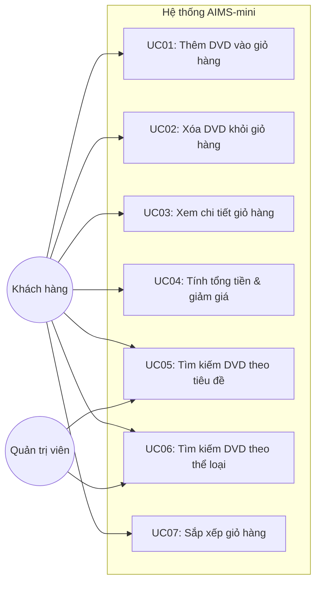

# Đặc tả Ca sử dụng (Use Case Specification) – AIMS-mini

- **Hệ thống**: Hệ thống quản lý giỏ hàng và danh mục media (An Internet Media Store - AIMS)
- **Mã học phần**: IT3180 – Nhập môn Công nghệ phần mềm
- **Sinh viên**: Nguyễn Thị Thảo Vy – MSSV: 202416408

---

## 1. Biểu đồ Ca sử dụng Tổng quan (Use Case Diagram)

---

## 2. Đặc tả Chi tiết các Ca sử dụng

### UC01: Thêm đĩa DVD vào giỏ hàng (Add DVD to Cart)
- **Tác nhân chính**: Khách hàng (Customer)
- **Tiền điều kiện**: Hệ thống đã khởi tạo đối tượng giỏ hàng `Cart`.
- **Luồng sự kiện chính**:
  1. Người dùng chọn một đĩa DVD và yêu cầu thêm vào giỏ hàng thông qua phương thức `add_dvd(dvd)`.
  2. Hệ thống kiểm tra số lượng đĩa hiện có trong giỏ hàng.
  3. Nếu số lượng hiện tại nhỏ hơn giới hạn tối đa (`MAX_NUMBERS_ORDERED = 20`):
     - Hệ thống thêm đĩa vào danh sách giỏ hàng.
     - Hiển thị thông báo: `Đã thêm đĩa '<title>' vào giỏ hàng`.
     - Trả về `True`.
- **Luồng ngoại lệ**:
  - Nếu số lượng đĩa trong giỏ hàng đã đạt giới hạn tối đa ($\ge 20$):
    - Hệ thống từ chối thêm đĩa.
    - Hiển thị thông báo: `The cart is almost full`.
    - Trả về `False`.

---

### UC02: Xóa đĩa DVD khỏi giỏ hàng (Remove DVD from Cart)
- **Tác nhân chính**: Khách hàng
- **Tiền điều kiện**: Giỏ hàng có ít nhất một đĩa DVD.
- **Luồng sự kiện chính**:
  1. Người dùng yêu cầu xóa một đĩa DVD khỏi giỏ hàng bằng phương thức `remove_dvd(dvd)`.
  2. Hệ thống kiểm tra sự tồn tại của đĩa trong giỏ.
  3. Nếu đĩa tồn tại, hệ thống xóa đĩa ra khỏi danh sách, hiển thị `The disc has been removed` và trả về `True`.
- **Luồng ngoại lệ**:
  - Nếu đĩa không có trong giỏ hàng, hệ thống thông báo `The disc is not in the cart` và trả về `False`.

---

### UC03: Xem chi tiết giỏ hàng (Print / View Cart)
- **Tác nhân chính**: Khách hàng
- **Luồng sự kiện chính**:
  1. Người dùng gọi hàm `print_cart()`.
  2. Hệ thống kiểm tra nếu giỏ hàng có sản phẩm:
     - In tiêu đề định dạng `***********************CART***********************`.
     - Liệt kê chi tiết từng đĩa theo mẫu: `<STT>. DVD - <Title> - <Category> - <Director> - <Length>: <Cost> $`.
     - In tổng số tiền của giỏ hàng.
- **Luồng ngoại lệ**:
  - Nếu giỏ hàng rỗng (`len(items) == 0`), hệ thống in ra thông báo: `The cart is empty`.

---

### UC04: Tính tổng tiền và áp dụng chiết khấu (Calculate Total Cost with Discount)
- **Tác nhân chính**: Khách hàng
- **Luồng sự kiện chính**:
  1. Người dùng yêu cầu tính tổng tiền thông qua `total_cost()` hoặc `total_cost_with_discount(percent)`.
  2. Hệ thống tính tổng tiền ban đầu của tất cả các đĩa.
  3. Nếu áp dụng giảm giá với `percent` hợp lệ ($0 \le percent \le 100$), hệ thống áp dụng công thức:
     $$\text{Discounted Total} = \text{Total} \times \frac{100 - percent}{100}$$
  4. Hệ thống trả về số tiền cuối cùng.
- **Luồng ngoại lệ**:
  - Nếu `percent < 0` hoặc `percent > 100`, hệ thống ném ra ngoại lệ `ValueError("Discount percentage must be between 0 and 100")`.

---

### UC05 & UC06: Tìm kiếm DVD (Search by Title / Category)
- **Tác nhân chính**: Khách hàng / Quản trị viên
- **Mô tả**:
  - `search_by_title(items, keyword)`: Tìm kiếm danh sách đĩa có tiêu đề chứa từ khóa tìm kiếm (không phân biệt chữ hoa, chữ thường - Case Insensitive).
  - `search_by_category(items, category)`: Tìm kiếm danh sách đĩa thuộc thể loại được chỉ định (không phân biệt chữ hoa, chữ thường).
- **Luồng xử lý**:
  - Nếu từ khóa tìm kiếm rỗng, hệ thống trả về toàn bộ danh sách đĩa ban đầu.
  - Ngược lại, lọc và trả về danh sách các đĩa thỏa mãn điều kiện.

---

### UC07: Sắp xếp giỏ hàng (Sort Cart)
- **Tác nhân chính**: Khách hàng
- **Mô tả**:
  - `sort_by_title()`: Sắp xếp các đĩa trong giỏ hàng theo thứ tự bảng chữ cái của tiêu đề (nếu trùng tiêu đề thì sắp xếp theo giá giảm dần).
  - `sort_by_cost()`: Sắp xếp các đĩa theo giá giảm dần (nếu trùng giá thì sắp xếp theo bảng chữ cái tiêu đề).
